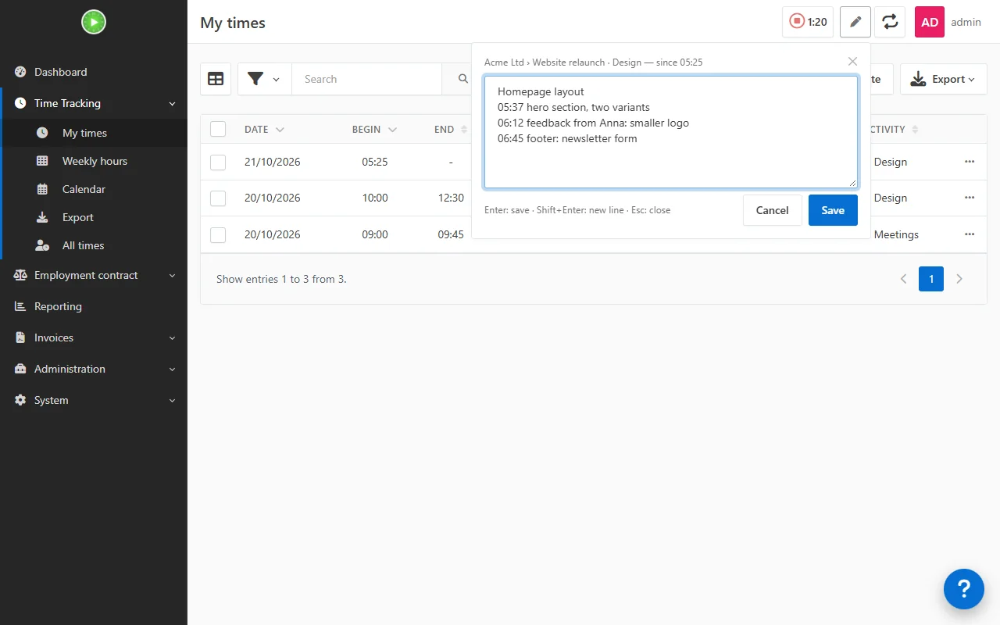

# TimerNotesBundle

A [Kimai](https://www.kimai.org) plugin to write the details of what you are doing while the timer runs, not only
when you start it.

Next to the stop button of the running timer, in the toolbar of every page, there is a pen button. It opens a
small box with the description of the running entry and a new line that already starts with the current time:

```
Homepage layout
10:12 hero section, two variants
10:47 feedback from Anna: smaller logo
11:05 ▌
```

Type the note and press **Enter**: the line is appended to the description and the timer keeps running.

- **Shift+Enter** starts another line, **Esc** or *Cancel* closes the box without saving.
- The time alone, with nothing typed after it, is not saved.
- The whole description can be edited in the box, e.g. to fix a typo in an earlier note.
- A click elsewhere closes the box, unless a note has been typed (so it is not lost).
- The lists reload after saving, and the description shows one note per line.



Kimai lets you edit the description of a running entry only in the full edit dialog (the start dialog, or the row
of the entry in *My times*); the toolbar has the stop button only.

## Requirements

Kimai 2. Tested with 2.69.0. The button appears for users who may edit their own timesheets
(`edit_own_timesheet`).

## Installation

The plugin directory must be called `TimerNotesBundle`:

```sh
cd /path/to/kimai/var/plugins
git clone https://github.com/6801318d8d/TimerNotesBundle.git
cd /path/to/kimai
bin/console kimai:reload --env=prod
```

With the official Docker image (replace `kimai` with the name of your container):

```sh
git clone https://github.com/6801318d8d/TimerNotesBundle.git
docker cp TimerNotesBundle kimai:/opt/kimai/var/plugins/
docker exec kimai chown -R www-data:www-data /opt/kimai/var/plugins/TimerNotesBundle
docker exec -u www-data kimai /opt/kimai/bin/console kimai:reload --env=prod
```

Run `kimai:reload` as `www-data`: run as root, it leaves cache files that the web server cannot write, and the API
answers with errors.

Mount `/opt/kimai/var/plugins` on a volume, otherwise the plugin is lost when the container is recreated.

To update it, run `git pull` in the plugin directory (or copy the new version over it) and run `kimai:reload`
again. To remove it, delete the `TimerNotesBundle` directory and run `kimai:reload` again.

## How it works

Through `ThemeEvent::STYLESHEET` and `ThemeEvent::JAVASCRIPT` the plugin adds a small style and script to every
page of a logged-in user. The script adds the button to the toolbar's timer menu (Kimai shows and hides it with the
running timer), reads the running entry from `GET /api/timesheets/active` when the button is clicked, and saves the
description with `PATCH /api/timesheets/{id}`. These API calls use the session of the page, as Kimai's own
frontend does, so no API token is needed. After saving it triggers Kimai's `kimai.timesheetUpdate` event, which
reloads the lists.

Times are those of the browser's clock (`HH:MM`). The description is stored as plain text, one note per line; Kimai
keeps the line breaks in its views, with or without Markdown enabled for descriptions.

The labels are translated (English and Italian; the buttons use Kimai's own translations). Nothing else is stored
by the plugin.

It hooks into Kimai's frontend (toolbar markup and JavaScript plugins), which is not a public API: a future Kimai
version may break it. In that case the button does not appear or the browser console shows an error; remove the
plugin and please open an issue.

## License

MIT
